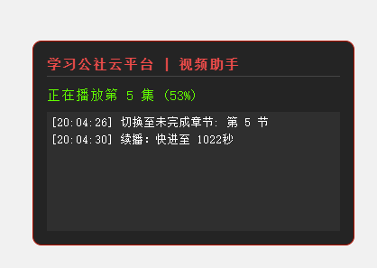

# 学习公社云平台 视频助手

一个用于自动化学习过程的浏览器扩展，旨在提高在线课程学习效率，支持断点续播和自动学习进度管理。

## 功能特性

### 视频播放控制
- **进度跟踪**：监控视频播放状态，自动记录播放位置
- **自动播放**：检测到暂停状态时自动恢复播放

### 智能学习管理
- **章节切换**：自动识别未完成章节并进行切换
- **进度计算**：根据学习进度百分比和视频总时长精确计算播放位置
- **休息弹窗处理**：自动检测并点击继续学习按钮

### 课程列表管理
- **智能扫描**：自动扫描课程列表，找到未完成的课程
- **自动跳转**：自动进入未完成的课程学习
- **状态同步**：维护学习状态，防止重复扫描

## 安装指南

1. 将此扩展添加到浏览器的开发者模式下
2. 授予访问 `study.enaea.edu.cn` 域名的权限
3. 扩展会在匹配的页面上自动运行

## 使用方法

1. 访问学习公社网站 (`study.enaea.edu.cn`)
2. 扩展会自动注入并开始运行
3. 在视频播放页面，扩展会显示状态面板
4. 扩展会自动处理视频播放、进度管理和章节切换

## 状态面板

页面右下角显示的状态面板包括：
- 系统运行状态信息
- 学习进度提示
- 操作日志记录

## 注意事项

- 此扩展专为 `study.enaea.edu.cn` 平台定制开发
- 请确保网络连接稳定以获得最佳体验
- 扩展会自动维护学习状态，无需手动干预

## 版本历史

- 1.5版：增加了基于学习进度和课件时长的智能续播功能
- 早期版本：基础的断点续播和进度管理功能

## 依赖项

- Chrome 或其他支持 Manifest V3 的现代浏览器
- JavaScript ES6+ 环境支持